# 模拟实盘简易上手文档

## 一、准备环节
- windows电脑或windows server服务器(支持云服务器)，跑通DEMO 2核2G即可
- [注册掘金量化账号](https://www.myquant.cn/)
- 下载并安装掘金客户端（万和 / 信达等券商版均可，以实际开通渠道为准）
- [Python安装包下载](https://www.python.org/downloads/windows/)(版本要求 > 3.10)

## 二、安装
1. 在windows机器上安装掘金客户端。常见安装路径示例：
   - 万和：`C:/Users/Administrator/AppData/Roaming/Vanho Goldminer3`
   - 信达：`C:/Users/Administrator/AppData/Roaming/Cindasc Goldminer`  
   若与上述不一致，请同步修改 `main/mtv/cronjob.py` 中的客户端启停路径，以及 `tool/` 下相关脚本中的项目路径。
2. 创建模拟实盘账户，取名为 develop（名称可自定义，后文以 develop 为例）
<div align="center">
    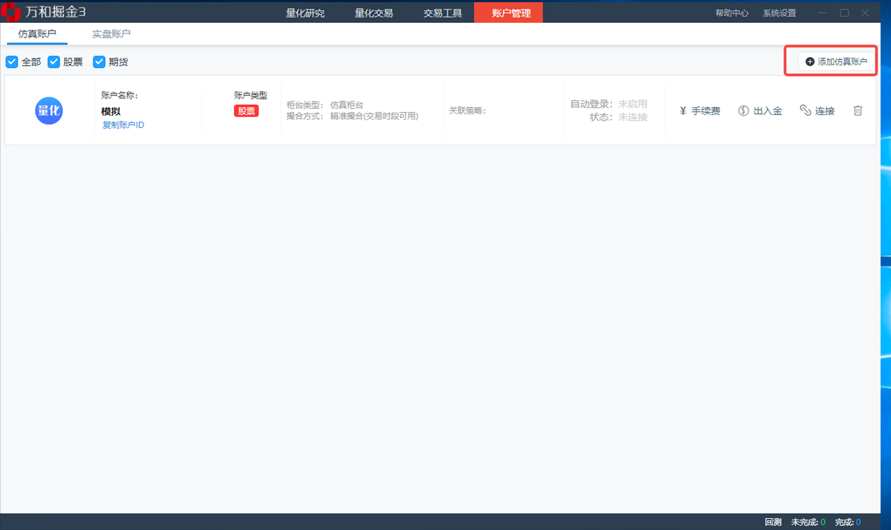
</div>

3. 创建策略，策略名称选择空策略，交易账号选择 develop
<div align="center">
    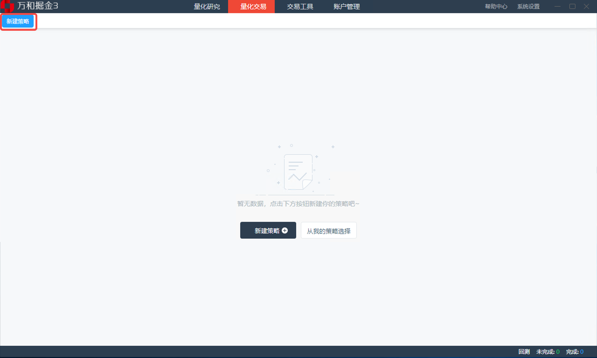  
</div>
<div align="center">
    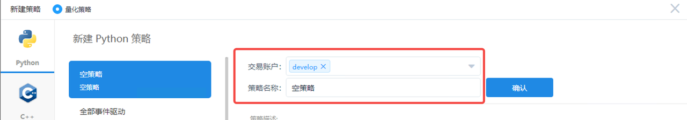
</div>
之后出现创建成功页面，此时需要记录 strategy id 和账户 token（重要！）
<div align="center">
    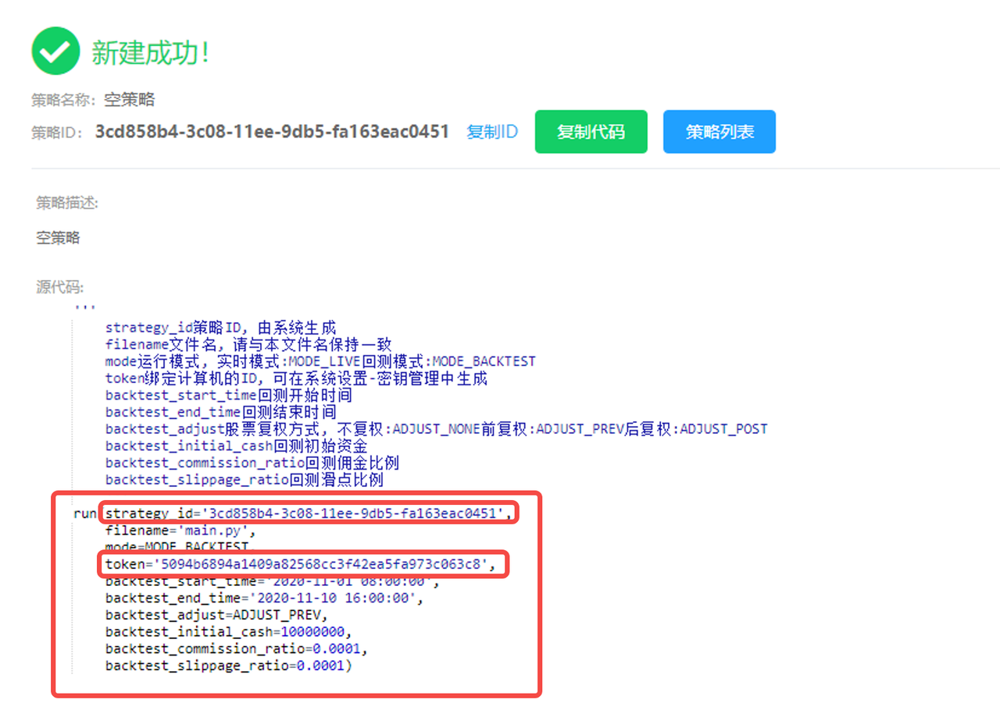
</div>

4. 安装 Python  
5. [下载并安装 Git](https://git-scm.com/download/win)  
6. 添加 ssh key，并下载本代码仓库，下载路径示例：`C:/Users/Administrator/Desktop/stock/CTBZStock`（可按本机实际路径调整，并同步修改 `tool/*.sh` 中的 `cd` 路径）  
7. 进入项目根目录  
8. 复制配置模板并填写密钥：
   ```bash
   copy config\cons_exam.py config\cons.py
   ```
   编辑 `config/cons.py`，将 `STRATEGY_ID`、`DATA_UPDATE_STRATEGY_ID`、`TOKEN` 替换为上述记录的对应值；模拟实盘请保持：
   ```python
   MODE = Mode.SIMU
   ```
   如需飞书通知，一并填写 `FEISHU_APP_ID`、`FEISHU_APP_SECRET`、`FEISHU_GROUP`。  
   注意：`config/cons.py` 含敏感信息，已被 `.gitignore` 忽略，请勿提交到仓库。
9. 安装相关依赖 `pip install -r requirements.txt`，速度慢可以切换国内源

## 三、运行
运行使用 windows 自带的 Task Scheduler，如果有更好的 windows 定时任务启动方案，可自行替换。

1. 在 Task Scheduler 中创建任务，先选中左侧目录，不然之后定时任务会找不到
<div align="center">
    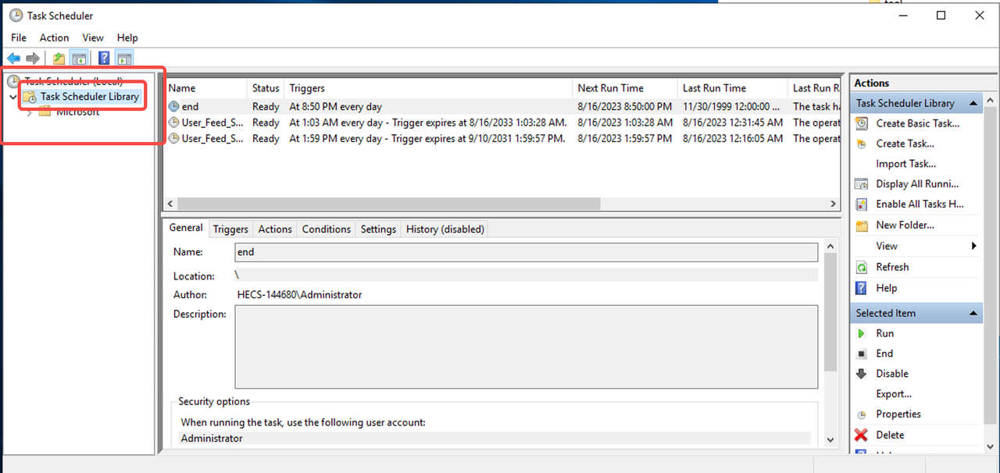
</div>
<div align="center">
    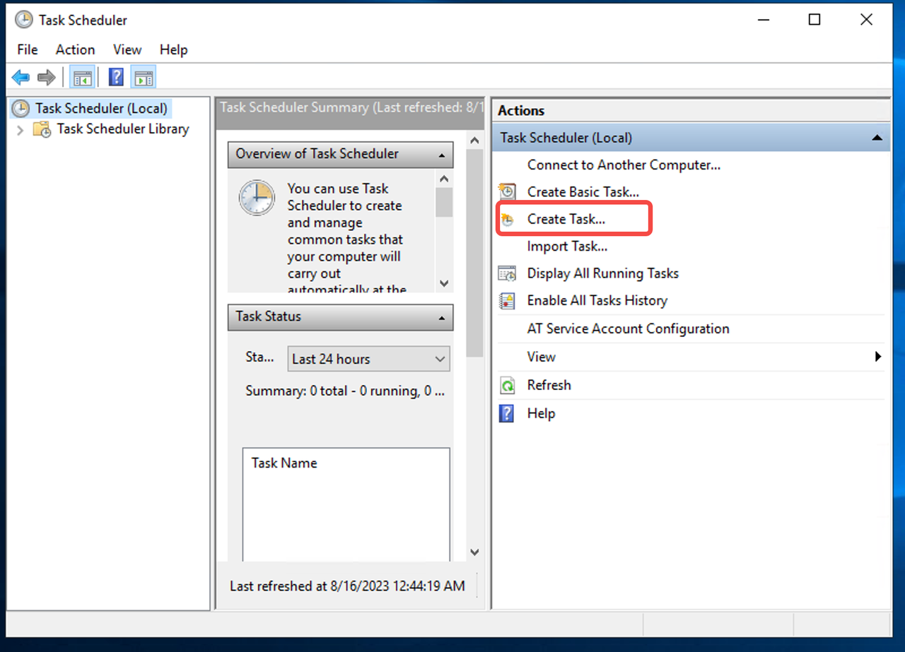
</div>

2. 创建任务：启动掘金客户端（可选）  
   若希望提前拉起客户端，可按下列步骤创建任务；当前 `main/mtv/cronjob.py` 启动时也会尝试启停客户端，二者按你的部署习惯二选一或配合使用即可。
<div align="center">
    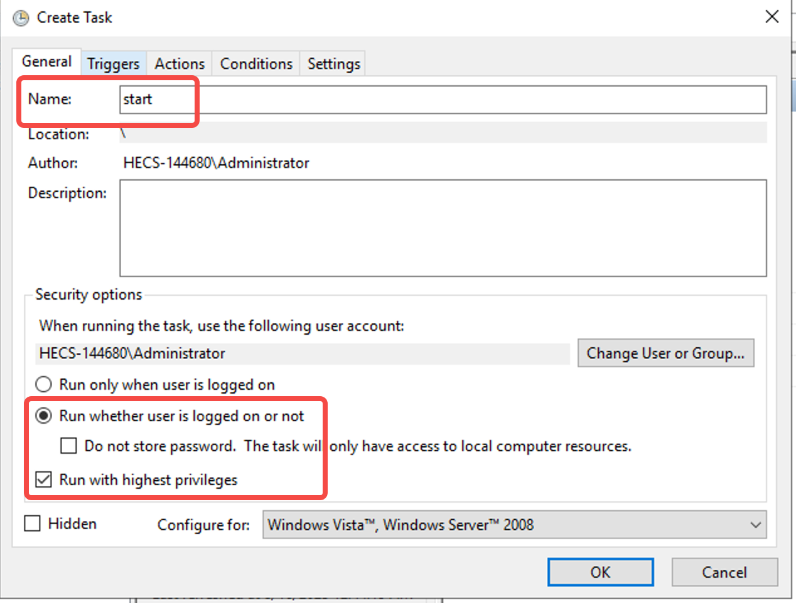
    <p>name随便填，勾选选项必须保持一致</p>
</div>
<div align="center">
    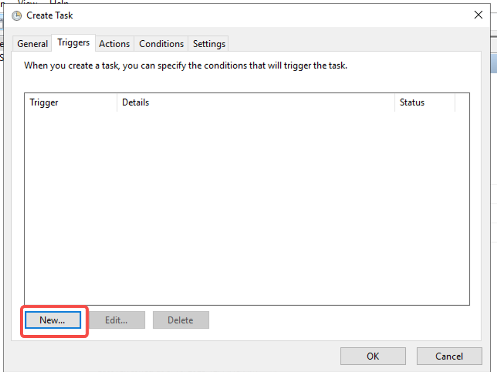
    <p>在trigger中new</p>
</div>
<div align="center">
    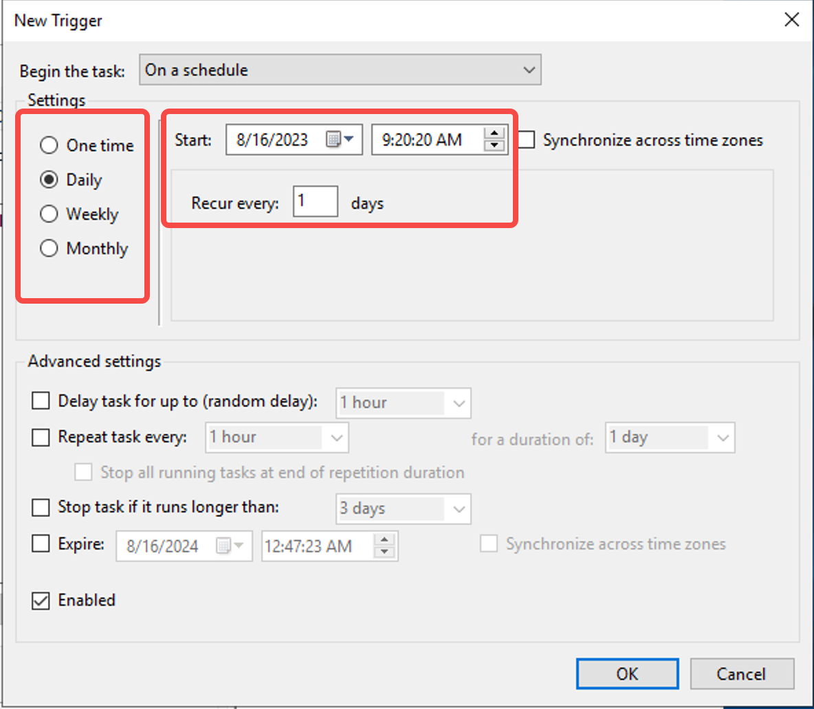
    <p>选择触发时间，每天上午9:20启动</p>
</div>
<div align="center">
    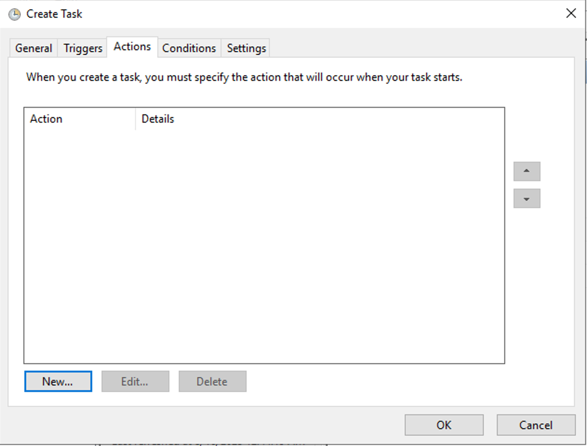
    <p>在Actions中new</p>
</div>
<div align="center">
    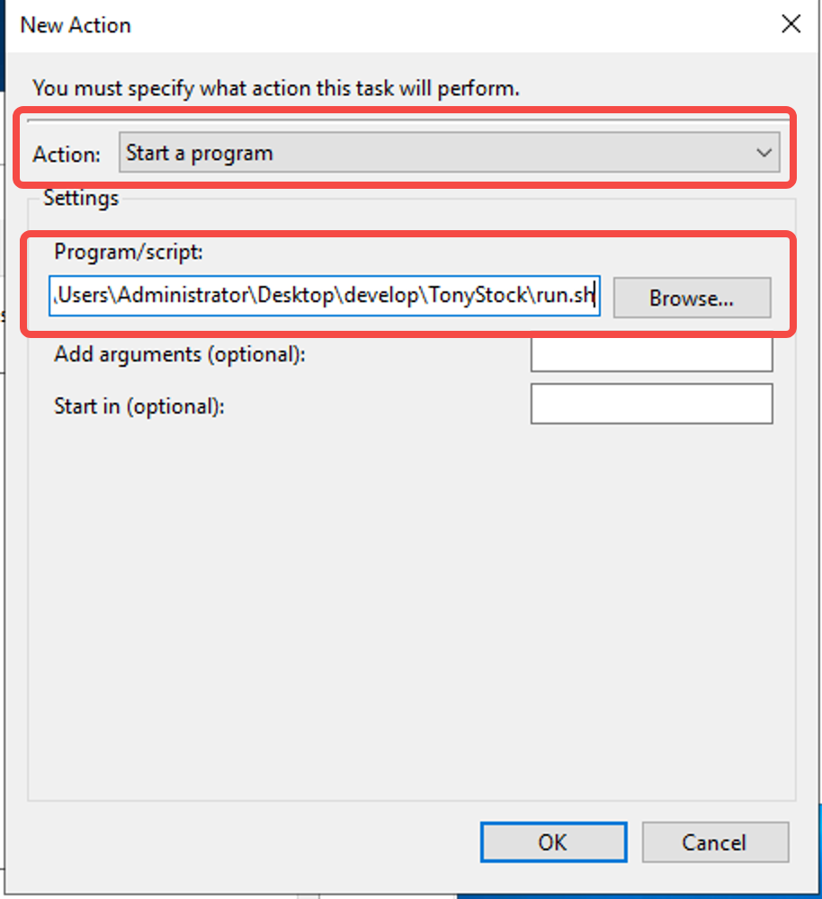
    <p>Action 选择如图；若自行编写启动脚本，请指向本机掘金客户端目录下的可执行文件</p>
</div>
点击 OK，生成任务

3. 创建任务：启动模拟实盘  
同上述启动任务步骤，启动时间改为 09:26:00（根据策略可自定义），启动脚本改为 `tool/mtv.sh`

4. 创建任务：关闭所有任务与客户端  
同上述启动任务步骤，启动时间改为 08:00:00，启动路径改为 `tool/shutdown.sh`
